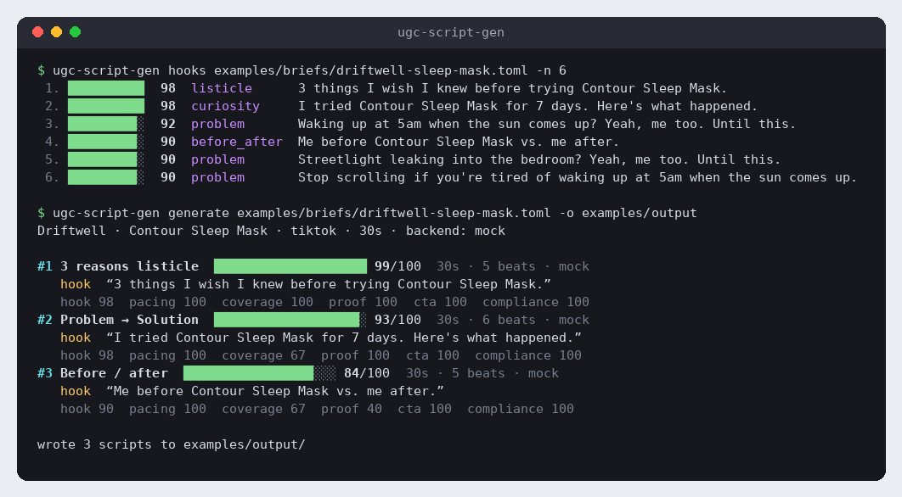

<div align="center">

# 🎥 ugc-script-gen

**Turn a one-page product brief into ranked, shot-ready UGC ad scripts and scroll-stopping hooks.**

[](https://github.com/hbtabi/ugc-script-gen/actions/workflows/ci.yml)


-412991?logo=openai&logoColor=white)
[](LICENSE)

</div>

Short-form ads live or die on the first 1.5 seconds. **ugc-script-gen** takes a brief (brand, audience, pain points,
benefits, proof, offer) and generates dozens of candidate hooks and scripts across proven UGC formats. It scores every
one with a transparent rubric and gives you the best few as **timed shot lists**: shot direction, on-screen text and
voice-over for each beat, ready for a creator or an AI-video pipeline.

It runs **fully offline** with zero runtime dependencies. If you set an OpenAI-compatible API key, an LLM proposes extra
hooks and polishes VO lines. Its output goes through the **same scorer**, and a rewrite that scores worse is thrown away.

I built it for the UGC / AI-video ad work at [Hasenix](https://github.com/hbtabi).

## 📸 Demo

<p align="center"></p>

- **Input:** [`examples/briefs/driftwell-sleep-mask.toml`](examples/briefs/driftwell-sleep-mask.toml) (fictional brand)
- **Output:** [`examples/output/`](examples/output), three Markdown shot lists plus a JSON bundle

A generated shot list (excerpt):

| # | Time | Shot | On-screen text | Voice-over |
|---|------|------|----------------|------------|
| 1 | 0:00.0–0:03.5 | Creator holds up three fingers, product in other hand | 3 reasons ↓ | 3 things I wish I knew before trying Contour Sleep Mask. |
| 2 | 0:03.5–0:10.0 | Demo shot #1 | 1. the room goes properly pitch black | One: the room goes properly pitch black. |
| … | … | … | … | … |
| 5 | 0:23.5–0:30.0 | Product hero on clean background, creator VO | Tap the link to try it ↓ | 4.8 stars from 2,100 reviews, so it's not just me. It's 20% off this week. Tap the link to try it. |

## ✨ Features

- **5 UGC formats:** problem → solution, talking-head testimonial, 3-reasons listicle, before/after, unboxing
- **7 hook angles:** problem, curiosity, POV, social proof, contrarian, listicle, before/after. Every template is filled for every pain point
- **Explainable scoring.** Hooks are scored on brevity, curiosity, specificity, direct address, relevance and compliance. Scripts are scored on hook, pacing, benefit coverage, proof, CTA and compliance
- **Runtime-aware timing.** Beats are timed to the exact duration. If the VO overruns (at 2.6 words/sec), lines are tightened and optional beats are dropped
- **Compliance flags** for banned claims in your brief, plus risky ad-copy terms ("guaranteed", "cure", "clinically proven"…)
- **Deterministic:** the same brief and `--seed` always give the same output, so you can diff runs and review them
- **Optional LLM.** Works with any OpenAI-compatible endpoint (OpenAI, OpenRouter, Groq, Ollama, LM Studio). If the call fails, you get the offline output
- **Outputs:** coloured terminal summary, Markdown shot lists, JSON

## 🚀 Quick start

```bash
git clone https://github.com/hbtabi/ugc-script-gen && cd ugc-script-gen
python -m venv .venv && source .venv/bin/activate
pip install -e ".[dev]"

ugc-script-gen hooks examples/briefs/driftwell-sleep-mask.toml -n 10
ugc-script-gen generate examples/briefs/driftwell-sleep-mask.toml -n 3 -o out/
ugc-script-gen generate examples/briefs/tidepool-hydration.toml -f before_after -d 15 --json
ugc-script-gen formats
```

### Writing a brief

```toml
brand = "Driftwell"
product = "Contour Sleep Mask"
category = "sleep mask"
audience = "light sleepers"
pain_points = ["waking up at 5am when the sun comes up", "masks that press on your eyes"]  # noun phrases
benefits = ["the room goes properly pitch black", "nothing touches my eyelids"]          # short first-person clauses
usp = "The moulded cups sit around your eyes, not on them."
proof = ["4.8 stars from 2,100 reviews"]
offer = "It's 20% off this week"
cta = "Tap the link to try it"
tone = "casual"        # casual | premium | playful | clinical
platform = "tiktok"    # tiktok | reels | shorts
duration = 30          # 10–90 seconds
banned_claims = ["cure insomnia", "medical"]
```

JSON briefs work too (see [`examples/briefs/lumen-desk-lamp.json`](examples/briefs/lumen-desk-lamp.json)).

### Using an LLM (optional)

```bash
export OPENAI_API_KEY=sk-...
export OPENAI_BASE_URL=https://api.openai.com/v1   # or http://localhost:11434/v1 for Ollama
export UGC_MODEL=gpt-4o-mini
ugc-script-gen generate examples/briefs/driftwell-sleep-mask.toml
```

Pass `--offline` to force the mock backend even when a key is set.

### Python API

```python
from ugc_script_gen import load_brief, generate_scripts
from ugc_script_gen.render import to_markdown

brief = load_brief("examples/briefs/driftwell-sleep-mask.toml")
best = generate_scripts(brief, n=1, seed=42)[0]
print(best.score.as_dict())
print(to_markdown(best))
```

## 🧮 How scoring works

| Script component | Weight | What it measures |
|---|---|---|
| hook | 30% | Hook rubric (0–100): ≤10 words, open loop, a number, "you/I/POV", brief relevance, no risky claims |
| pacing | 20% | VO words ÷ (duration × 2.6 wps). The sweet spot is 70–100% |
| coverage | 20% | How many of your top 3 benefits are actually said or shown |
| proof | 10% | Is a proof point (reviews, sales, press) used? |
| cta | 10% | Does the final beat contain your CTA? |
| compliance | 10% | −50 per banned or risky claim |

All weights live in [`scoring.py`](src/ugc_script_gen/scoring.py) and are easy to tune.

## 🗂️ Project structure

```
ugc-script-gen/
├── src/ugc_script_gen/
│   ├── brief.py        # Brief dataclass + TOML/JSON loader and validation
│   ├── templates.py    # hook angles, tone sign-offs, 5 beat-by-beat formats
│   ├── generator.py    # candidate generation, timing, tightening, ranking, LLM polish
│   ├── scoring.py      # explainable hook & script rubrics, claim detection
│   ├── llm.py          # OpenAI-compatible client (urllib) + offline MockLLM
│   ├── render.py       # Markdown shot lists, JSON, coloured terminal summary
│   └── cli.py          # `ugc-script-gen hooks | generate | formats`
├── examples/briefs/    # three fictional brand briefs
├── examples/output/    # generated sample scripts
├── tests/              # pytest suite (incl. a local fake LLM server)
└── docs/demo.png
```

## 🛣️ Roadmap

- [ ] Brand voice profiles learned from past winning scripts
- [ ] Export to CSV / Google Sheets for creator briefs
- [ ] Caption file (`.srt`) export with beat timings
- [ ] Hook A/B tracker: import ad-platform CTR to recalibrate scoring weights
- [ ] Multi-language briefs

## 📄 Licence

[MIT](LICENSE) © 2026 Mohammed Hassan bin Tayyeb. All brands in `examples/` are fictional.
